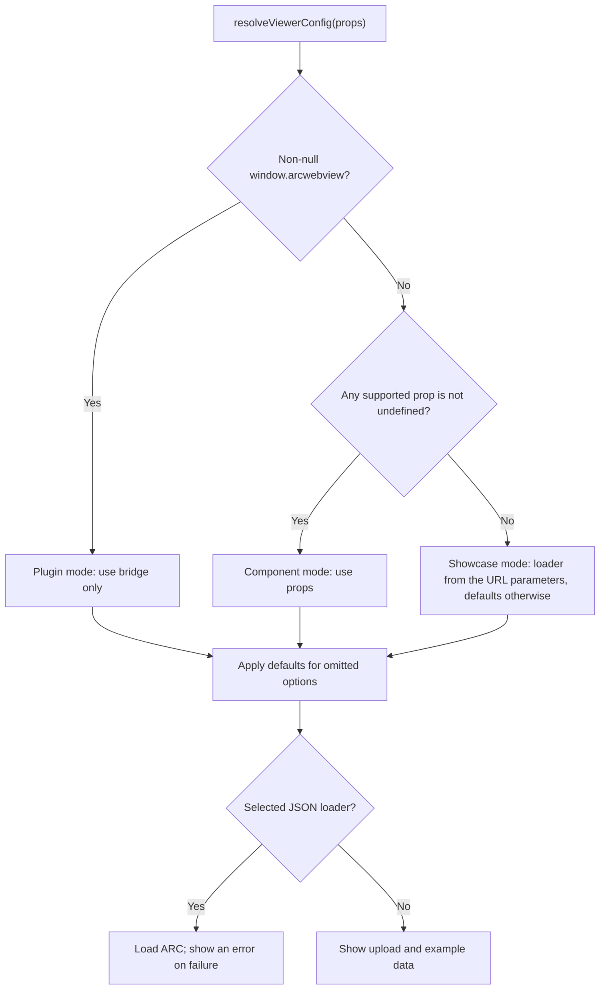

# @nfdi4plants/arc-web-view 


[](https://doi.org/10.5281/zenodo.17937200)

An Annotated Research Context web viewer in the style of GitHub's Primer ProductUI.

Displays basic information about an ARC ([Annotated Research Context](https://arc-rdm.org/)) and allows to navigate through its structure.

👀 check out the [demo](https://nfdi4plants.github.io/ARCWebView/)

# Install

```bash
npm i @nfdi4plants/arc-web-view
```

```tsx
import { StrictMode } from 'react'
import { createRoot } from 'react-dom/client'
import { BaseStyles, ThemeProvider } from '@primer/react'
import '@primer/primitives/dist/css/functional/themes/light.css'
import "@primer/css/dist/primer.css";
import '@nfdi4plants/arc-web-view/style.css'
import { WebViewer } from '@nfdi4plants/arc-web-view'


createRoot(document.getElementById('root')!).render(
  <StrictMode>
    <ThemeProvider>
      <BaseStyles>
        <WebViewer /> // will load with empty view
      </BaseStyles>
    </ThemeProvider>
  </StrictMode>,
)

```

`@nfdi4plants/arc-web-view/style.css` holds the styles of the provenance graph. The JavaScript does not load it, so import it once in your application. Without it the graph has no layout and no colors.

# Using the parts separately

`WebViewer` is the whole viewer: a file tree in the sidebar, and the file browser and the provenance graph as two tabs. The three parts are also exported on their own, for a page that arranges them itself.

```tsx
import { useMemo } from 'react'
import { FileBrowser, FileTree, ProvenanceGraph, loadCrate } from '@nfdi4plants/arc-web-view'

function Arc({ json }: { json: string }) {
  // Parse once per document and keep the result.
  const crate = useMemo(() => loadCrate(json), [json])
  return (
    <>
      <ProvenanceGraph crate={crate} height={500} />
      <FileBrowser crate={crate} />
    </>
  )
}
```

`loadCrate(json)` parses the text of a `ro-crate-metadata.json` and returns a crate. It runs synchronously and throws when the text is not a crate the viewer can read. Every part takes the crate as a prop. Parsing is the expensive step and the parts start over for a new crate, so keep the crate in a memo or in state. Parts that get the same crate share its file tree and provenance index. A crate has two readable fields, `kind` (`'arc'`, `'run'` or `'workflow'`) and `landingPath`.

| Part | What it shows | Props |
| --- | --- | --- |
| `FileBrowser` | Search, breadcrumbs, the listing of a folder and the content of a file. It has no file tree and no page layout. | `crate`, `location`, `defaultLocation`, `onLocationChange`, `headerStart`, `headerActions` |
| `ProvenanceGraph` | The provenance graph. A workflow crate has none and shows a short note instead. | `crate`, `nav`, `defaultNav`, `onNavChange`, `actions`, `height` |
| `FileTree` | The folders and files as a tree. You pass the current path and handle each selection. | `crate`, `currentPath`, `onSelect`, `isSelectable` |

`FileBrowser` and `ProvenanceGraph` each keep their own place when you pass only the crate. To hold the place yourself, pass `location` with `onLocationChange` to the file browser, or `nav` with `onNavChange` to the graph. The part then shows what it is given and reports each navigation through the callback. A `location` is `{ path, table? }`. `path` is a file or folder of the crate and `''` is the root. `table` names an annotation table of the isa file at `path`, and without it the first tab of the file is open. A `nav` is a `Navigation` object from `onNavChange` or `locationToNavigation`.

Three functions connect the parts:

- `landingLocation(crate)` is where the file browser starts: the run or workflow folder of such a crate, and the root of a full ARC.
- `locationToNavigation(crate, location)` gives the place in the graph that belongs to a file or folder. It returns `undefined` when the graph has no such place.
- `navigationToLocation(crate, nav)` gives the file or folder that belongs to a place in the graph, or `undefined` when there is none.

The two mappings do not round-trip. Most files of an assay lead to its process view, and that view leads back to the assay folder.

This example lets the tree drive both other parts:

```tsx
function Wired({ crate }: { crate: Crate }) {
  const [location, setLocation] = useState(() => landingLocation(crate))
  const [nav, setNav] = useState<Navigation>({ view: 'datasets' })
  return (
    <>
      <FileTree
        crate={crate}
        currentPath={location.path}
        onSelect={(path) => {
          setLocation({ path })
          const target = locationToNavigation(crate, { path })
          if (target) setNav(target)
        }}
      />
      <ProvenanceGraph crate={crate} nav={nav} onNavChange={setNav} />
      <FileBrowser crate={crate} location={location} onLocationChange={setLocation} />
    </>
  )
}
```

`FileTree` opens the folders above `currentPath` and marks that item. An item for which `isSelectable` returns `false` cannot be selected. Such a folder opens and closes on a click, and such a file is shown muted.

The graph takes its height from `height`. Without it the graph is `70vh` high and at least `420px`. The `t` key focuses the search box of the file browser, except while the user types in another field or the browser is hidden.

# Supported input

The viewer reads the `ro-crate-metadata.json` of a full ARC. It also reads the file of a Workflow RO-Crate (one ARC workflow) and of a Workflow Run Crate (one ARC run), as ARCtrl writes them with `writeWorkflowAsCrate` and `writeRunAsCrate`. The DataPLANT endpoint-submission service uploads this format to WorkflowHub. Pass the file through the ROC-JSON loader (see [Entry points and configuration](#entry-points-and-configuration)), use "Upload ROC-JSON" in the demo, or open the demo with the crate named in its address (see [Showcase URL parameters](#showcase-url-parameters)).

No prop or option selects the kind. The viewer detects it from the crate. The Workflow Run Crate profile on the root dataset marks a run crate, and the Workflow RO-Crate profile on the metadata descriptor or the root dataset marks a workflow crate. The viewer reads every other file as a full ARC, as before.

The viewer reads JSON only. Crates downloaded from WorkflowHub are zip files, so extract `ro-crate-metadata.json` from the zip and pass or upload that file. A public WorkflowHub entry can also be opened with the `workflowhub` URL parameter, which loads the JSON without the zip.

A crate opens on its run or workflow folder (`runs/<id>` or `workflows/<id>`). A run crate also shows its process tables and the provenance graph. A workflow crate has no provenance graph, so the viewer shows its files without the tabs.

If a file declares one of these profiles but cannot be read as an ARC run or workflow (for example a crate from another tool without a root `identifier`), the viewer shows an error with the reason.

Limits:

- The crate JSON-LD does not carry the full CWL, so step wiring and requirements are missing. The viewer does not display CWL.
- Packed crates carry no `sha256` or `contentSize`, so their files get no download links.

# Development

This component uses GitHubs Primer ProductUI.

Find more information below:

- Components: https://primer.style/product/components/
- Responsive: https://github.com/primer/css/blob/b5e009778ec01b6e983cba6cbf89cebfdc5a4124/docs/content/support/breakpoints.md#media-query-mixins

## Entry points and configuration

The application entry point is `src/main.tsx`; the npm library exports `WebViewer` through `src/lib.ts`. Both use `App`, which calls [`resolveViewerConfig` in `src/config.ts`](src/config.ts) as the single decision point for configuration:



| Priority | Entry point | Configuration source |
| --- | --- | --- |
| 1 | Embedded in an iframe by the Invenio plugin | `window.arcwebview`, including an empty `{}` |
| 2 | Used as a component in another React application | Supported component props, when the bridge is absent |
| 3 | GitHub Pages showcase | Defaults and a JSON loader from the `url` or `workflowhub` query parameter, when neither a bridge nor supported prop values are supplied |

The bridge is an explicit convention for plugin mode. It takes precedence over **all** component props. Missing bridge fields use defaults, without falling back to props. An absent or `null` bridge allows component mode. React passes a props object even for `<WebViewer />`, so the resolver checks supported values against `undefined`; `showUnloadButton: false` selects component mode and hides the unload button. Supplying only `layout` also selects component mode, including an empty `{}`. Unrelated props do not affect the decision.

| Option | Bridge field | React prop | Default |
| --- | --- | --- | --- |
| Asynchronous ROC-JSON loader | `getROCJson` | `jsonString` | No loader; in showcase mode, one from the [URL parameters](#showcase-url-parameters) |
| Show unload button | `showUnloadButton` | `showUnloadButton` | `true` |
| Initially open file sidebar | `layout.sidebarOpen` | `layout.sidebarOpen` | `false` |
| Tab that is open first | `layout.initialTab` | `layout.initialTab` | `'files'` |

The loader returns `Promise<string>`. The optional bridge and its settings share one TypeScript declaration in `src/config.ts`. `ArcWebViewBridge`, `WebViewerProps`, `LayoutOptions`, and `ViewerTab` are exported from the npm library. Boolean defaults use [nullish coalescing (`??`)](https://developer.mozilla.org/en-US/docs/Web/JavaScript/Reference/Operators/Nullish_coalescing), preserving explicit `false`.

For example, with a `loadArcJson` callback supplied by the integration:

```ts
// Initialize inside the Invenio iframe before React mounts.
window.arcwebview = {
  getROCJson: loadArcJson,
  showUnloadButton: false,
  layout: { sidebarOpen: true, initialTab: 'provenance' },
};
```

```tsx
// In another React app, with no window.arcwebview bridge:
<WebViewer
  jsonString={loadArcJson}
  showUnloadButton={false}
  layout={{ sidebarOpen: true, initialTab: 'provenance' }}
/>

// With neither bridge nor props, use the showcase defaults:
<WebViewer />
```

`layout` sets the initial state when ARC content mounts. Both fields are optional and default independently, so `layout={{ initialTab: 'provenance' }}` starts with the sidebar closed and the graph tab open. `initialTab` is `'files'` or `'provenance'`, and a workflow crate always opens on its files. On small screens, an open sidebar appears as a side sheet and closes after a selection in the tree.

The file browser and the provenance graph are two tabs, and each keeps its own place when you switch. The "Show in provenance graph" and "Show in file viewer" buttons open the other tab on the matching place, and each is shown only when there is one. The file tree in the sidebar navigates the open tab. On the graph tab a file or folder leads to its place in the graph, the isa file of a dataset to its processes, and a file the graph has no place for is shown muted. A folder without a place, such as `assays`, opens and closes on a click.

Users can change these states after loading. Updating `layout` props on an already mounted viewer does not reset them; remount the component (for example, with a new React `key`) to apply new initial values. Clearing and reloading ARC content also applies the initial layout again.

Without a selected JSON loader, all modes start with an empty view offering upload and example data. With a loader, the viewer shows a spinner until loading completes. Only the selected source's loader runs; a failure displays an error without trying another source. When the selected loader changes, previous ARC data, errors, and example mode are cleared. Results from superseded requests or unmounted viewers are ignored. [React Strict Mode](https://react.dev/reference/react/useEffect#my-effect-runs-twice-when-the-component-mounts) may invoke the selected loader again during development, so loaders should be safe to repeat.

Integration considerations:

- Initialize the bridge in the iframe's own window before mounting React. Setting it on the parent page does not configure the iframe; direct iframe access is subject to the [same-origin policy](https://developer.mozilla.org/en-US/docs/Web/API/HTMLIFrameElement/contentWindow). Cross-origin integrations need communication such as `postMessage`, with bridge initialization inside the iframe.
- Bridge mutation is not reactive. For later configuration changes, use React props in component mode, or remount the plugin viewer after updating its bridge. Keep loader references stable to avoid unnecessary reloads.
- Every viewer in the same window shares the bridge. Use props in a window without a bridge for independently configured React instances.
- The resolver guards access to `window`, allowing configuration resolution during server rendering. Data loading starts after the component mounts in the browser.

### Showcase URL parameters

The showcase (`https://nfdi4plants.github.io/ARCWebView/`) can open a crate named in its address. There are two parameters.

#### Any crate URL

```
https://nfdi4plants.github.io/ARCWebView/?url=<percent-encoded URL of a ro-crate-metadata.json>
```

The viewer fetches the URL as it is and shows the crate. The URL must be absolute and use http or https. The browser fetches it from the viewer's page, so the server has to allow cross-origin reads (`Access-Control-Allow-Origin`); otherwise the viewer shows an error. Any service can link to the viewer this way.

#### A WorkflowHub entry

```
https://nfdi4plants.github.io/ARCWebView/?workflowhub=2380
```

`workflowhub` is the numeric entry id. `host` is optional and can be `workflowhub.eu` (default) or `dev.workflowhub.eu`; any other value is an error and nothing is fetched. WorkflowHub's own pages do not allow cross-origin reads, but its GA4GH TRS API does. Every TRS crate URL names a version, so the viewer first reads the version list from `/ga4gh/trs/v2/tools/<id>/versions`, takes the highest numeric version id, and then loads `/ga4gh/trs/v2/tools/<id>/versions/<n>/PLAIN_CWL/descriptor/ro-crate-metadata.json` through the same loader as `url`. The link therefore always opens the latest version. A `url` link to that TRS address opens one fixed version.

Only public entries work. A private or unknown entry returns 404, and the viewer says the entry was not found or is not public.

Use one of the two parameters; both together is an error. The resolver reads them only in showcase mode, so a bridge or any supported component prop makes the viewer ignore the query string. `App` resolves the configuration again only when a supported prop changes, so the loader built from the query string keeps its identity and runs once per page load.

## Requirements

- installed NodeJS (v20 or higher)

## Run locally

1. Install dependencies `npm install` (once per setup)
2. Start development server `npm start`

Run the configuration regression tests with `npm test`. The same command runs `tests/crateLoader.test.mjs` against the fixtures in `tests/fixtures/`. They hold an invented run and workflow, written as crates with ARCtrl 3.3.1 `writeRunAsCrate` and `writeWorkflowAsCrate`, the same writers the endpoint-submission packer uses. `tests/linking.test.mjs` and `tests/crate.test.mjs` cover the mapping between file paths and places in the provenance graph.

## Publish components

1. Apply changes
2. Change version in `package.json`
3. Build component library `npm run build:lib`

> [!NOTE]  
> Remember to login before the next step (verify with `npm whoami`).
>
> `npm login` to authenticate your npm account before publishing.

4. Publish component library `npm publish --access public` (or use `npm publish --access public --tag next` for prerelease) 

## Deploy to GitHub Pages

1. Deploy using `gh-pages` npm library: `npm run deploy`

## Build WebApp 

1. Build web app using `npm run build`
