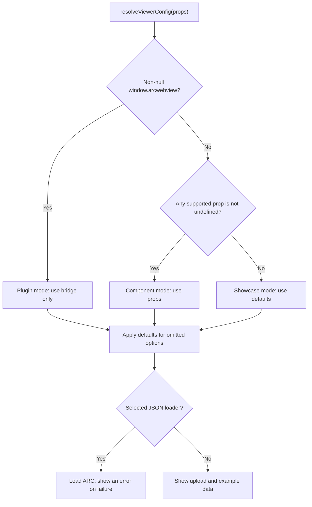

# @nfdi4plants/arc-web-view 


[](https://doi.org/10.5281/zenodo.17937200)

An Annotated Research Context web viewer in the style of GitHub's Primer ProductUI.

Displays basic information about an ARC ([Annotated Research Context](https://arc-rdm.org/)) and allows to navigate through its structure.

👀 check out the [demo](https://nfdi4plants.github.io/ARCWebView/)

# Install

```bash
npm i @nfdi4plants/arc-web-view
```

```tsx
import { StrictMode } from 'react'
import { createRoot } from 'react-dom/client'
import { BaseStyles, ThemeProvider } from '@primer/react'
import '@primer/primitives/dist/css/functional/themes/light.css'
import "@primer/css/dist/primer.css";
import { WebViewer } from '@nfdi4plants/arc-web-view'


createRoot(document.getElementById('root')!).render(
  <StrictMode>
    <ThemeProvider>
      <BaseStyles>
        <WebViewer /> // will load with empty view
      </BaseStyles>
    </ThemeProvider>
  </StrictMode>,
)

```

# Development

This component uses GitHubs Primer ProductUI.

Find more information below:

- Components: https://primer.style/product/components/
- Responsive: https://github.com/primer/css/blob/b5e009778ec01b6e983cba6cbf89cebfdc5a4124/docs/content/support/breakpoints.md#media-query-mixins

## Entry points and configuration

The application entry point is `src/main.tsx`; the npm library exports `WebViewer` through `src/lib.ts`. Both use `App`, which calls [`resolveViewerConfig` in `src/config.ts`](src/config.ts) as the single decision point for configuration:



| Priority | Entry point | Configuration source |
| --- | --- | --- |
| 1 | Embedded in an iframe by the Invenio plugin | `window.arcwebview`, including an empty `{}` |
| 2 | Used as a component in another React application | Supported component props, when the bridge is absent |
| 3 | GitHub Pages showcase | Defaults, when neither a bridge nor supported prop values are supplied |

The bridge is an explicit convention for plugin mode. It takes precedence over **all** component props. Missing bridge fields use defaults, without falling back to props. An absent or `null` bridge allows component mode. React passes a props object even for `<WebViewer />`, so the resolver checks supported values against `undefined`; `showUnloadButton: false` selects component mode and hides the unload button. Unrelated props do not affect the decision.

| Option | Bridge field | React prop | Default |
| --- | --- | --- | --- |
| Asynchronous ROC-JSON loader | `getROCJson` | `jsonString` | No loader |
| Asynchronous README loader | `readmefetch` | `readmefetch` | No README |
| Asynchronous license loader | `licensefetch` | `licensefetch` | No license |
| Show unload button | `showUnloadButton` | `showUnloadButton` | `true` |

All loaders return `Promise<string>`. The optional bridge and its settings share one TypeScript declaration in `src/config.ts`; `ArcWebViewBridge` and `WebViewerProps` are exported from the npm library. Boolean defaults use [nullish coalescing (`??`)](https://developer.mozilla.org/en-US/docs/Web/JavaScript/Reference/Operators/Nullish_coalescing), preserving explicit `false`.

For example, with a `loadArcJson` callback supplied by the integration:

```ts
// Initialize inside the Invenio iframe before React mounts.
window.arcwebview = { getROCJson: loadArcJson, showUnloadButton: false };
```

```tsx
// In another React app, with no window.arcwebview bridge:
<WebViewer jsonString={loadArcJson} showUnloadButton={false} />

// With neither bridge nor props, use the showcase defaults:
<WebViewer />
```

Without a selected JSON loader, all modes start with an empty view offering upload and example data. With a loader, the viewer shows a spinner until loading completes. Only the selected source's loader runs; a failure displays an error without trying another source. When the selected loader changes, previous ARC data, errors, and example mode are cleared. Results from superseded requests or unmounted viewers are ignored. [React Strict Mode](https://react.dev/reference/react/useEffect#my-effect-runs-twice-when-the-component-mounts) may invoke the selected loader again during development, so loaders should be safe to repeat.

Integration considerations:

- Initialize the bridge in the iframe's own window before mounting React. Setting it on the parent page does not configure the iframe; direct iframe access is subject to the [same-origin policy](https://developer.mozilla.org/en-US/docs/Web/API/HTMLIFrameElement/contentWindow). Cross-origin integrations need communication such as `postMessage`, with bridge initialization inside the iframe.
- Bridge mutation is not reactive. For later configuration changes, use React props in component mode, or remount the plugin viewer after updating its bridge. Keep loader references stable to avoid unnecessary reloads.
- Every viewer in the same window shares the bridge. Use props in a window without a bridge for independently configured React instances.
- The resolver guards access to `window`, allowing configuration resolution during server rendering. Data loading starts after the component mounts in the browser.

## Requirements

- installed NodeJS (v20 or higher)

## Run locally

1. Install dependencies `npm install` (once per setup)
2. Start development server `npm start`

Run the configuration regression tests with `npm test`.

## Publish components

1. Apply changes
2. Change version in `package.json`
3. Build component library `npm run build:lib`

> [!NOTE]  
> Remember to login before the next step (verify with `npm whoami`).
>
> `npm login` to authenticate your npm account before publishing.

4. Publish component library `npm publish --access public` (or use `npm publish --access public --tag next` for prerelease) 

## Deploy to GitHub Pages

1. Deploy using `gh-pages` npm library: `npm run deploy`

## Build WebApp 

1. Build web app using `npm run build`
